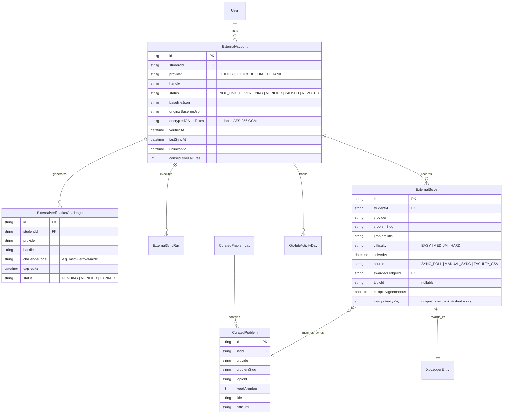
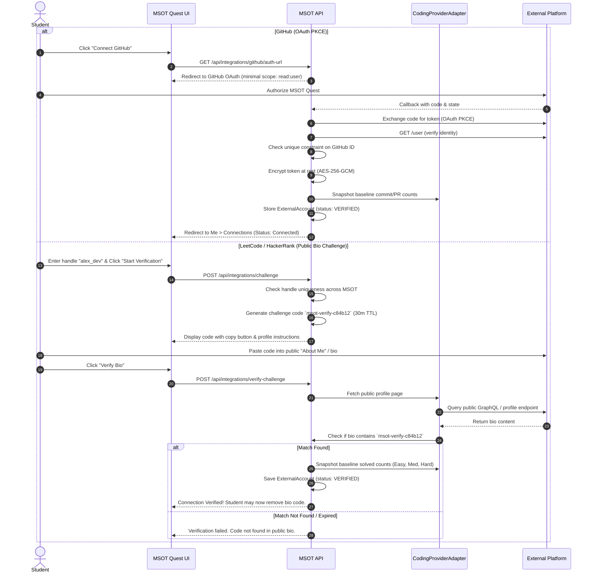
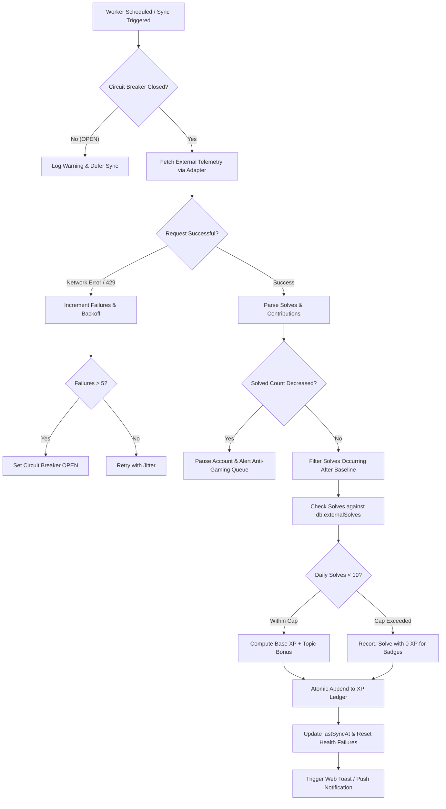

# MSOT Quest — External Coding Integrations Design Document

**Document Version:** 1.0.0  
**Status:** Approved for Implementation  
**Date:** 2026-10-20  
**Scope:** Verified coding practice integration with GitHub, LeetCode, and HackerRank  
**Authors:** Senior Full-Stack Engineer & Game Systems Architect  

---

## 1. Executive Summary & Architectural Principles

The MSOT Quest platform recognizes verifiable student effort across everyday learning activities. Prior to this design, coding practice within the platform was evaluated through internal interactive code runners. This system extends verification to real-world developer platforms: **GitHub**, **LeetCode**, and **HackerRank**.

### Core Tenets

1. **Learning First**: Every XP award represents a genuine, independently verifiable learning achievement. Pure account creation, idle profile links, or trivial commits earn **zero game points**.
2. **Fair & Inclusive**: External platform integration is **completely optional**. Students who lack external accounts, high-speed internet, or personal laptops can achieve the same daily XP caps and mastery milestones through in-app code challenges, quests, and peer reviews.
3. **Separate From Grades**: External coding XP feeds the gamified progression ledger (levels, streaks, cosmetics, leagues) and **never** alters official academic transcripts or exam scores.
4. **Honest Provider Realism**: We acknowledge that LeetCode and HackerRank lack official public student APIs. All providers sit behind a decoupled, capability-flagged adapter architecture with circuit breakers and mock fixtures, allowing MSOT administrators to toggle unofficial integrations without system degradation.
5. **Zero Credential Custody**: MSOT Quest **never** requests, accepts, or stores student passwords, session cookies, or unauthorized tokens for external sites. GitHub relies on official read-only OAuth, while LeetCode and HackerRank rely solely on public profile verification and faculty-uploaded CSV verification.

---

## 2. Provider Capability Matrix

Each integration adheres to the `CodingProviderAdapter` contract, declaring explicit capabilities:

| Capability Flag | GitHub | LeetCode | HackerRank | Description |
|---|:---:|:---:|:---:|---|
| **Official Public API** (`official`) | **YES** | **NO** | **NO** | Backed by platform-supported, versioned public API and terms. |
| **Authentication Flow** | OAuth 2.0 (read-only) | Public Profile Challenge | Public Profile Challenge / Faculty CSV | Method used to verify account ownership. |
| **Ownership Proof** (`supportsOwnershipProof`) | **YES** (OAuth PKCE) | **YES** (Bio Token Verification) | **OPTIONAL** (Bio / Faculty Roster) | Cryptographic or challenge-based account association. |
| **Per-Problem Telemetry** (`supportsPerProblemSubmissions`) | N/A (Commit/PR) | **YES** (Recent Accepted List) | **NO** (Only Star/Badge counts in public API) | Exposes individual problem slugs, titles, and timestamps. |
| **Solved Counts by Difficulty** (`supportsSolvedCounts`) | N/A | **YES** (Easy / Medium / Hard) | **PARTIAL** (Skill badges & star levels) | Aggregated bucket counts across difficulty tiers. |
| **Difficulty Metadata** (`supportsDifficulty`) | N/A | **YES** (Easy / Med / Hard) | **NO** (General domain stars) | Categorization of problem cognitive load. |
| **Topic Tagging Support** | Repo labels | Problem Tags | Domain Badges | Ability to map practice to MSOT syllabus topics. |
| **Faculty CSV Fallback** | Not needed | Supported | **PRIMARY RECOMMENDED** | Offline contest, lab, or test CSV upload with dry-run preview. |
| **Admin Feature Flag** | `ENABLE_GITHUB_SYNC` | `ENABLE_LEETCODE_SYNC` | `ENABLE_HACKERRANK_SYNC` | Immediate administrative pause/disable toggle. |

---

## 3. Data Model Architecture

The data model enforces strict relational integrity, idempotency, and tamper-resistance:



### Key Entity Definitions

1. **`ExternalAccount`**: Stores connection status, verified handle, and **immutable baseline JSON**. If a student unlinks and later relinks the same account, `originalBaselineJson` is restored to prevent farming historic solves.
2. **`ExternalVerificationChallenge`**: Generates a 30-minute cryptographically random challenge code (e.g. `msot-verify-a7f92e`) for bio-verification on LeetCode/HackerRank.
3. **`ExternalSolve`**: Normalized record of each unique problem solved. Contains an immutable unique constraint: `[provider, studentId, problemSlug]`, guaranteeing zero double-awards.
4. **`ExternalSyncRun`**: Tracks sync duration, detected solves, awarded XP, and provider HTTP response status for health auditing.
5. **`ProviderHealth`**: Maintains stateful circuit breaker metrics (`CLOSED`, `OPEN`, `HALF_OPEN`) per provider.
6. **`CuratedProblemList` & `CuratedProblem`**: Faculty-defined mapping connecting external problem slugs (e.g., `two-sum`, `invert-binary-tree`) to course topics (e.g., `hashing`, `trees`) and academic weeks.

---

## 4. Ownership Verification & Account Linking Protocols



### Security & Constraint Rules
- **Unique Handle Invariant**: One external platform handle cannot be linked to more than one MSOT account simultaneously.
- **Relink Cooldown & Baseline Preservation**: Unlinking introduces a 24-hour relink cooldown. When an account is reconnected, the **original link baseline** is preserved, ensuring no historic solves completed before the first link date can be cashed in.
- **Cosmetic Linking Badge**: Linking an account awards the **"Connected Developer"** cosmetic title and badge with **0 XP**, reinforcing the principle that connecting an account is not a paid action.

---

## 5. Sync Engine Architecture & Idempotency

The sync worker operates via BullMQ (or resilient in-memory queue in development) on a jittered 30- to 60-minute cadence, plus an on-demand **"Sync Now"** trigger rate-limited to once every 5 minutes per student.



### Idempotent XP Calculation Rules

```typescript
function calculateSolveXp(
  difficulty: 'EASY' | 'MEDIUM' | 'HARD',
  isTopicAligned: boolean,
  currentDayExternalSolvesCount: number
): { xp: number; reason: string } {
  // Enforce 10-problem daily cap across all external providers
  if (currentDayExternalSolvesCount >= 10) {
    return {
      xp: 0,
      reason: 'Daily external practice cap reached (10 solves/day). Counted towards mastery badges.',
    };
  }

  const baseMap = {
    EASY: 10,
    MEDIUM: 20,
    HARD: 40,
  };
  const base = baseMap[difficulty] || 10;
  const bonus = isTopicAligned ? Math.round(base * 0.25) : 0;
  const total = base + bonus;

  return {
    xp: total,
    reason: isTopicAligned
      ? `Verified ${difficulty} problem solved (+${bonus} topic bonus)`
      : `Verified ${difficulty} problem solved`,
  };
}
```

---

## 6. Threat Model & Anti-Gaming Verification Defenses

| Attack Vector | Threat Scenario | Architectural Defense & Mitigation |
|---|---|---|
| **1. Fake / Borrowed Handle** | Student enters an elite competitive programmer's handle (e.g. `tourist`, `neal_wu`) to steal points. | **Blocked by Ownership Challenge**: The student must enter an ephemeral cryptographic code into the public bio within 30 minutes, or complete OAuth. |
| **2. Historic Solves Cash-in** | Student has 600 LeetCode problems solved before joining MSOT and expects 12,000 XP instantly. | **Link-Time Baseline**: The system records `baselineSolvedCounts` at the moment of verification. Only delta solves created *after* the baseline are eligible for XP. |
| **3. Re-link Farming** | Student unlinks account, solves problems, and relinks hoping to reset the baseline. | **Permanent Baseline Invariant**: `originalBaselineJson` is permanently saved on the first link and restored upon relinking. Solves are deduplicated globally. |
| **4. Bot Scripting / Velocity Spikes** | Student runs an automated solver submitting 50 problems in 10 minutes. | **Velocity Anomaly Detection**: More than 5 solves within 15 minutes flags an anomaly, pauses automated awards, and routes to the Faculty Audit Queue. Daily cap limits maximum damage to 10 solves. |
| **5. Count Decreases / Account Swap** | Student attempts to switch the handle or external profile deletes solutions. | **State Tamper Detection**: If solved count ever drops, the sync worker immediately locks the integration into `PAUSED` status and alerts admins. |
| **6. GitHub Commit Farming** | Student creates automated bots making 100 whitespace/dummy commits a day. | **Quality Commit Gate**: Commits to forks are ignored. Commits must contain >= 10 non-whitespace modified lines in valid programming languages. Capped at 1 active coding day award (10 XP) per 24 hours. |
| **7. Multi-Account Collisions** | Two students in the same batch attempt to connect the same GitHub or LeetCode account. | **Global Unique Constraint**: `db.externalAccounts` enforces strict single-ownership of external IDs/handles. The second attempt is rejected with HTTP 409 Conflict. |
| **8. Credential Theft via Phishing** | An attacker attempts to intercept student LeetCode credentials. | **Zero-Credential Policy**: MSOT Quest never provides input boxes for external passwords or session tokens. |

---

## 7. Faculty Curation & CSV Fallback System

For institutions or classrooms hosting internal HackerRank contests or localized coding assessments where public API endpoints do not capture individual submissions:

1. **Faculty Curated Problem Lists**:
   - Faculty create lists tagged to Syllabus Topics (e.g. "Week 4: Recursion & Backtracking").
   - Faculty paste problem slugs from LeetCode or HackerRank.
   - When a student solves a problem matching the active week's list, the sync engine awards a **+25% Topic-Aligned Bonus**.
2. **Faculty Contest CSV Import**:
   - Allows upload of contest export CSVs (`student_email,problem_slug,score,passed_at`).
   - Implements **two-phase dry-run preview**: validates student email matches the institutional roster, checks for duplicates, and presents a confirmation dialog before committing XP to the append-only ledger.

---

## 8. Circuit Breaker & Polite Client Specifications

All outbound network requests to third-party platforms follow resilient, non-intrusive scraping and API consumption standards:

- **Custom User-Agent**: `MSOT-Quest-Learning-Platform/1.0 (+https://msot.edu.in/quest-bot; educational-verification)`
- **Polite Rate Limiting**: Maximum 1 outbound request per 3 seconds per provider globally.
- **Circuit Breaker Thresholds**:
  - `CLOSED`: Normal operation.
  - `OPEN`: 5 consecutive network errors or HTTP 429 Too Many Requests trips the breaker for 15 minutes.
  - `HALF_OPEN`: Probes 1 request after timeout; restores `CLOSED` on success.
- **Graceful UI Degradation**: When a circuit breaker is open, the student UI displays:  
  *“LeetCode sync is temporarily resting to respect platform rate limits. Your progress is safe and will sync automatically.”*

---

## 9. Verification & Acceptance Criteria

1. **Unit & Security Tests**:
   - `tests/unit/coding-integrations.test.js`: Verifies provider adapters, capability flags, baseline delta calculation, topic bonuses, and daily caps.
   - `tests/security/coding-anti-gaming.test.js`: Tests all 8 threat model attack vectors (fake handles, historic solves, solve spikes, commit spam, duplicate account collisions).
2. **E2E Simulation**:
   - Verify GitHub OAuth mock flow.
   - Verify LeetCode bio challenge challenge generation and verification.
   - Verify HackerRank badge detection and faculty CSV import.
3. **Ledger Integrity**:
   - Every award has a distinct `idempotencyKey` and metadata tag.
   - Zero double-awards on multiple sync runs.
