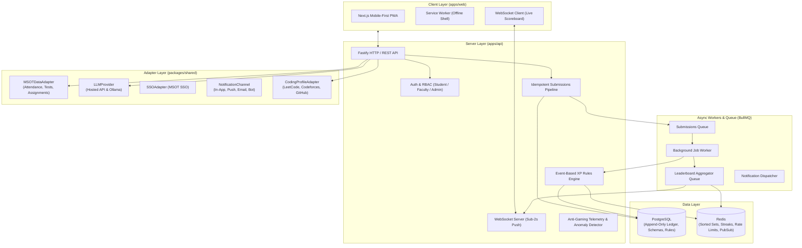

# MSOT Quest — Master Implementation Plan

## 1. System Architecture & Overview

MSOT Quest is a gamified learning platform engineered to transform academic coursework, coding practice, and tests into an engaging, fair, and cheat-resistant game. The architecture follows a strict domain separation: learning actions drive game progression, while game mechanics strictly never modify academic grading.

### 1.1 High-Level Architecture Diagram



### 1.2 Monorepo Structure
```
msot-quest/
├── apps/
│   ├── api/                 # Fastify backend, WebSocket server, BullMQ workers
│   └── web/                 # Next.js mobile-first PWA, Tailwind, Framer Motion
├── packages/
│   └── shared/              # Shared TypeScript contracts, DTOs, XP math, constants
├── docs/
│   ├── PLAN.md              # Architecture & roadmap
│   ├── ASSUMPTIONS.md       # Documented system assumptions
│   └── TEST_REPORT.md       # Empirical verification of all test requirements
├── tests/
│   ├── unit/                # XP engine, rules, anti-gaming tests
│   ├── integration/         # API endpoint and submission pipeline tests
│   ├── privacy/             # Automated identity leakage checks
│   ├── fairness/            # Bottom-quartile student simulation
│   └── load/                # k6 load testing scripts (100, 300, 500 users)
├── docker-compose.yml       # Production/demo container orchestration
└── README.md                # Setup, seed, test, and load-test documentation
```

---

## 2. Data Model

The database is built on relational integrity (PostgreSQL) combined with high-speed volatile data structures (Redis).

### 2.1 Core Relational Entities

1. **User Management & Academics**:
   - `User`: `id, email, password_hash, role (STUDENT, FACULTY, ADMIN), name, avatar_id, anonymous_alias, is_anonymous, campus_id, batch_id, section_id, created_at`
   - `Campus`: `id, code, name, city`
   - `Batch`: `id, campus_id, name, year`
   - `Section`: `id, batch_id, name`
   - `Course`: `id, code, title, description`
   - `Topic`: `id, course_id, week_number, title, description, order_index, is_active`
   - `WeeklyTopicSchedule`: `id, topic_id, week_number, start_date, end_date, is_unlocked`

2. **XP Engine & Ledger (Append-Only)**:
   - `XPRule`: `id, action_type, base_xp, formula, daily_limit, per_item_limit, enabled, effective_from, version, description`
   - `XPRuleVersion`: `id, rule_id, version, base_xp, formula, daily_limit, per_item_limit, changed_by, reason, created_at`
   - `XPLedger`: `id, student_id, rule_id, rule_version, source_type, source_ref, base_amount, final_amount, is_diminished, reason, metadata (JSON), idempotency_key (UNIQUE), is_voided, void_reason, void_by, void_ref_id, created_at`
   - `StudentProfile`: `student_id (PK), lifetime_xp, current_level, spendable_shards, current_streak, max_streak, freeze_count, last_active_date`

3. **Curriculum, Questions & Quizzes**:
   - `Question`: `id, topic_id, prompt, options (JSON), correct_option_index, difficulty (EASY, MEDIUM, HARD), language (EN, HINGLISH), explanation, explanation_hinglish, source (FACULTY, AI), status (PENDING, APPROVED, EDITED, REJECTED), reviewer_id, review_notes`
   - `QuizAttempt`: `id, student_id, date, status (STARTED, COMPLETED), score, max_score, started_at, completed_at, idempotency_key`
   - `QuizAnswer`: `id, quiz_attempt_id, question_id, selected_option, is_correct, response_time_ms, paste_detected, typing_telemetry (JSON)`

4. **Game Feel, Mistake Monsters & Codex**:
   - `MonsterSpecies`: `id, topic_id, name, title, rarity (COMMON, ELITE, BOSS), image_url, lore`
   - `MistakeMonster`: `id, student_id, species_id, question_id, wrong_count, status (ACTIVE, DEFEATED), next_revenge_at, defeated_at`
   - `MonsterCodexEntry`: `id, student_id, species_id, defeat_count, first_defeated_at`

5. **Cosmetics, Chests & Variable Drops**:
   - `Cosmetic`: `id, name, type (AVATAR_SKIN, COMPANION_SKIN, FRAME, TITLE, BACKGROUND, STREAK_FLAME, LEVELUP_EFFECT), rarity (COMMON, UNCOMMON, RARE, EPIC, LEGENDARY), shard_cost, achievement_locked, required_achievement`
   - `UserCosmetic`: `id, student_id, cosmetic_id, is_equipped, unlocked_at`
   - `Chest`: `id, student_id, tier (WOODEN, SILVER, GOLDEN, LEGENDARY), source, status (UNOPENED, OPENED), opened_at`
   - `ChestDropTable`: `id, chest_tier, rarity, weight`
   - `PityCounter`: `student_id (PK), chests_since_rare, chests_since_epic`

6. **Social, Leagues & Battles**:
   - `League`: `id, name, tier (BRONZE, SILVER, GOLD, PLATINUM, DIAMOND), season_id`
   - `LeagueWeek`: `id, league_id, week_number, start_date, end_date, is_closed`
   - `LeagueMembership`: `id, league_week_id, student_id, start_xp, current_xp, rank, shield_active`
   - `TeamEvent`: `id, title, type (SECTION_VS_SECTION, CAMPUS_VS_CAMPUS, RAID_BOSS), start_time, end_time, min_participation_rate, boss_max_hp, boss_current_hp`
   - `Team`: `id, event_id, name, campus_id, section_id`
   - `TeamSubmission`: `id, team_id, student_id, event_id, points, created_at`

7. **Anti-Gaming, Audit & Pilots**:
   - `AnomalyFlag`: `id, student_id, flag_type, severity (LOW, MEDIUM, HIGH), evidence (JSON), status (PENDING, REVIEWED, VOIDED, DISMISSED), flagged_at, reviewed_by, review_notes`
   - `AuditLog`: `id, actor_id, action, target_type, target_id, details (JSON), ip_address, created_at`
   - `PilotFeedback`: `id, student_id, rating, favorite_mechanic, struggle_points, comments, created_at`
   - `AnalyticsEvent`: `id, user_id, event_name, properties (JSON), created_at`

### 2.2 Redis Data Structures
- `leaderboard:league:{league_week_id}`: Sorted Set (`student_id` -> `xp`)
- `leaderboard:campus:{campus_id}:{week_number}`: Sorted Set (`student_id` -> `xp`)
- `leaderboard:batch:{batch_id}:{week_number}`: Sorted Set (`student_id` -> `xp`)
- `leaderboard:event:{event_id}`: Sorted Set (`team_id` / `student_id` -> `points`)
- `streak:student:{student_id}`: Hash (`count`, `last_active_date`, `freezes`)
- `ratelimit:{ip/user}:{endpoint}`: Sliding window counter

---

## 3. Core Engine Mechanics & Formulas

### 3.1 Idempotent XP Engine
- Every XP award generates an idempotency key: `HASH(student_id, source_type, source_ref, date)`.
- If key exists in `XPLedger`, duplicate requests are silently returned with original result.
- Daily soft XP cap (default: 150 XP per day):
  $$\text{effective\_xp} = \begin{cases} 
  \text{raw\_xp} & \text{if } \text{daily\_total} + \text{raw\_xp} \le 150 \\
  \max(1, \lfloor \text{raw\_xp} \times 0.5 \rfloor) & \text{if } \text{daily\_total} \ge 150 \\
  (150 - \text{daily\_total}) + \lfloor (\text{raw\_xp} - (150 - \text{daily\_total})) \times 0.5 \rfloor & \text{otherwise}
  \end{cases}$$
- Voiding: An admin or faculty flags an anomaly and voids XP. A compensating transaction is inserted with negative `final_amount`, referencing the original entry ID, author ID, and mandatory rationale.

### 3.2 Level Curve
Levels follow a progressive curve:
$$\text{XP to reach Level } L = 100 \times L^{1.5}$$
Levels 1 through 50 provide milestones, cosmetic unlocks, and title upgrades.

### 3.3 Anti-Gaming Vectors
1. **Quiz spam/retries**: Strict 1 scored daily attempt enforced via database constraint and Redis daily key.
2. **Shared answer clustering**: Jaccard similarity index on response options & timing vector comparison ($\Delta t < 200\text{ms}$ flag threshold).
3. **Copy-paste telemetry**: Client captures paste events, keystroke intervals, and free-text Levenshtein similarity.
4. **Fake coding profiles**: Challenge verification code in public bio; solve timestamp deduplication; rate limit of 10 solves/day.
5. **XP spike detection**: Z-score calculation on student's 7-day rolling average ($Z > 3.0$ triggers `AnomalyFlag`).

---

## 4. Implementation Phases

- **Phase 0: Foundation & Infrastructure**
  - Scaffold monorepo (`apps/api`, `apps/web`, `packages/shared`).
  - Configure PostgreSQL, Redis, Docker Compose, `.env.example`.
  - Database schema & migration setup.
  - Comprehensive seed script: 1,000+ realistic students across 4 campuses, batches, sections, courses, 200+ syllabus-tagged questions.
- **Phase 1: Core XP Engine & Ledger**
  - Authentication & Role-Based Access Control (Student, Faculty, Admin) + SSOAdapter interface.
  - Append-only `XPLedger` with idempotency, compensating voids, and daily soft cap.
  - Dynamic `XPRule` engine with admin CRUD and preview.
  - `MSOTDataAdapter` with Mock and CSV/JSON importers (attendance, homework, tests).
  - Strict grade isolation verification test.
- **Phase 2: The Daily Habit Loop**
  - Syllabus tree & Weekly schedule management.
  - Question bank with AI generation via `LLMProvider` (Hosted + Ollama) and Faculty Approval Queue.
  - "Today's Run" core loop: 3-5 daily questions, adaptive difficulty, streak tracker, freeze days, make-up quest.
  - Mistake Monsters & Codex: topic-tied monsters, spaced repetition revenge rounds (1/3/7 days), rarity tiers.
  - Quests & Badges system (Milestones & Improvement Badges).
- **Phase 3: Leagues & Social Dynamics**
  - 20-student weekly leagues, promotion/relegation tiers, relegation shields.
  - Campus & Batch boards.
  - Server-side anonymization filter (alias generation, zero identity leakage).
  - Ghost Mode (compete against previous week's performance) & Improvement Ranking.
- **Phase 4: Battles & Faculty Operations**
  - Team battles (Section vs Section, Campus vs Campus) with sub-2s WebSocket scoreboards and participation floor.
  - Co-op Raid Boss with shared HP reduction.
  - Faculty Dashboard: engagement heatmaps, struggling topics, quiet student nudges, question reviews, XP void tools.
  - Automated anti-gaming detection suite & Admin audit interface.
- **Phase 5: Game Feel & Polish**
  - Sound effects toggle, confetti, level-up modals, prefers-reduced-motion support.
  - Companion evolution & Cosmetic rarity system (Common to Legendary), Collection Book.
  - Mystery chests, pity timer, duplicate shard crafting, seasonal track.
  - Smart notifications & quiet hours.
- **Phase 6: Stretch Features & Verification**
  - Coding profiles adapter (LeetCode / Codeforces / GitHub verification).
  - Rewards Store with lifetime XP vs spendable shards separation.
  - AI Study Buddy with Hinglish/English toggle.
  - Load testing suite (k6: 100, 300, 500 users, 300-student battle test) and complete `docs/TEST_REPORT.md`.

---

## 5. Verification & Test Strategy

Every required verification in Section 11 of the specification will be executed and recorded in `docs/TEST_REPORT.md`:
1. **XP Correctness**: 10 deterministic student scenarios compared against expected mathematical fixtures.
2. **Grade Immutability**: Code inspection and automated test asserting no write path exists to official grade repositories.
3. **Anti-Gaming**: Automated test cases for 5 distinct attack vectors with anomaly flag assertions.
4. **Quiz Quality**: Faculty review tracking with acceptance/edit/rejection metrics.
5. **Engagement Pilot Simulation**: 2-week batch analytics, DAU, completion rates, and feedback export.
6. **Fairness**: Mathematical simulation showing bottom-quartile student earning promotions and badges within 7 days.
7. **Privacy Leakage**: Automated scanning across all API payloads, WebSockets, and exports for unmasked anonymous profiles.
8. **Scalability**: k6 benchmarks at 100, 300, and 500 concurrent connections, including 300 concurrent battle submissions.
